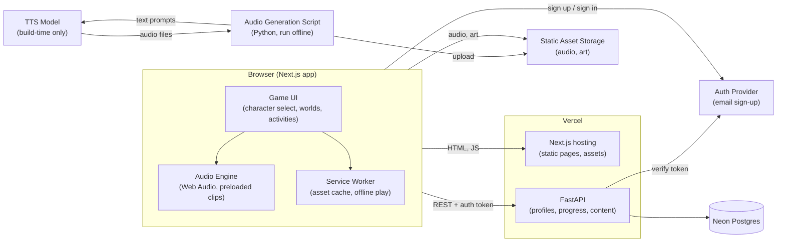
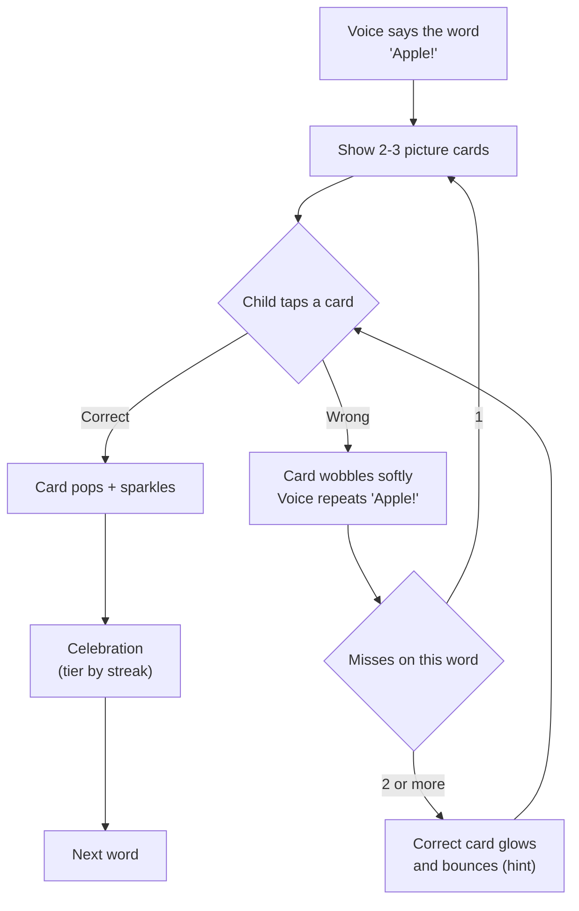
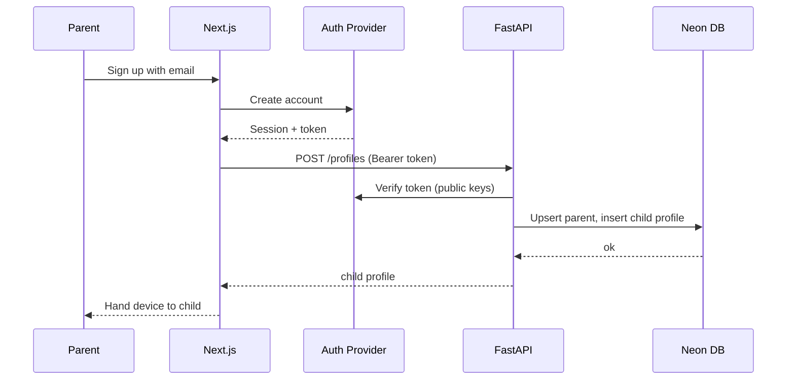

# Kids English Game: End-to-End System Design

Status: Draft v0.1 (brainstorm to architecture)
Audience: kids ages 1 to 5 (core band to be confirmed), parents as account owners
Stack: Next.js (frontend), FastAPI (backend), Vercel (hosting), Neon Postgres (database, recommended), TTS-only audio, free-tier email auth

---

## 1. Product Summary

A cute, tap-first English learning game for toddlers and preschoolers. The child picks a friendly character. Each character owns a world (animals, colors, numbers, food, and so on) and teaches English words and short phrases through chants, songs, and tap-to-hear play. Progress is shown as stars, stickers, and character growth, never as scores or failures.

Voice is generated only by a TTS model. There are no recorded human voices and no live conversation.

### Core game loop (the heart of the product)
1. The character's voice says a word, for example **"Apple!"**
2. The screen shows 2 to 3 big visual picture cards (apple, cat, ball).
3. The child taps the card they think matches the word.
4. **Correct:** a celebration plays (a happy chant or song, sparkles, the character dances) with motivating praise.
5. **Wrong:** a gentle retry, the word is repeated, and a hint appears after repeated misses. Never a buzzer or a penalty.

See section 8.1 for the full spec.

### Goals
- Toddler can play with zero reading and zero help after the parent signs in.
- Instant audio response on every tap (no waiting).
- Parent has a simple, safe account area with progress visibility.
- Cheap to run, easy to extend with new words and worlds.

### Non-goals (v1)
- Real singing voices or music generation.
- Speech recognition or pronunciation scoring.
- Multiplayer, chat, or any user-generated content.
- Ads or third-party tracking.

---

## 2. Design Principles (Kid-First)

1. **No reading required.** Everything is picture, sound, and motion.
2. **No fail states.** A wrong tap gets a gentle "try again" sound, never a buzzer, a lost life, or a timer.
3. **Big targets.** Minimum tap target 96 px, ideally 120 px or more. Toddlers tap imprecisely.
4. **Instant feedback.** Audio and animation respond within 100 ms of a tap.
5. **Short sessions.** Natural stopping points every 3 to 5 minutes.
6. **Parent gate.** Anything involving accounts, settings, or leaving the app sits behind a simple parent-only check.
7. **Minimal data.** Store only what is needed to save progress.

---

## 3. Users and Core Flows

### 3.1 Actors
| Actor | Description |
|---|---|
| Parent | Signs up with email, creates child profile(s), views progress, manages settings |
| Child | Plays the game; never sees login, email, or settings |

### 3.2 Parent flow
1. Opens the app, taps **Sign up**, enters email (and password or magic link, depending on provider).
2. Creates a child profile (nickname and age band only).
3. Hands the device to the child.
4. Later, passes the parent gate to view progress or change settings.

### 3.3 Child flow
1. Lands on **Character Select** (big cute characters).
2. Taps a character, which opens that character's world.
3. Plays activity loops: hear a word, tap the matching picture, celebrate.
4. Collects stickers and unlocks outfits and new worlds.

---

## 4. Tech Stack

| Layer | Choice | Notes |
|---|---|---|
| Frontend | Next.js (App Router), TypeScript | Mostly client-side game UI; static-friendly |
| Styling | Tailwind CSS plus a kid design-token file | See section 13 |
| Animation | Framer Motion (UI), CSS or Lottie for characters | Keep bundles small |
| Audio | Web Audio API plus preloaded static audio clips | See section 7 |
| Backend | FastAPI (Python) | Progress, profiles, content manifest |
| Hosting | Vercel | Frontend and API (two projects in one monorepo recommended) |
| Database | Neon Postgres (recommended) | Alternative: Cloudflare D1; see section 15 |
| Static asset storage | Vercel static assets, Vercel Blob, or Cloudflare R2 | Audio and art files |
| Auth | Free-tier provider with email sign-up (provider TBD) | See section 11 |
| TTS | A single TTS model or API (provider TBD) | Used offline at build time, not live |

---

## 5. High-Level Architecture



### Key architectural decision
**TTS runs at build time, not at play time.** The word list is small and fixed, so every clip is generated once, stored as a static file, and served from a CDN. This gives instant playback, no TTS outage risk, and near-zero runtime cost.

---

## 6. Repository Layout

```
kids-english/
├── apps/
│   ├── web/                    # Next.js frontend
│   │   ├── app/
│   │   │   ├── (child)/        # play area, no auth UI visible
│   │   │   │   ├── select/     # character select
│   │   │   │   ├── world/[id]/ # a character's world
│   │   │   │   └── play/[activity]/
│   │   │   ├── (parent)/       # behind parent gate
│   │   │   │   ├── dashboard/
│   │   │   │   └── settings/
│   │   │   └── (auth)/         # sign up / sign in
│   │   ├── components/
│   │   ├── lib/audio/          # audio engine
│   │   ├── lib/api/            # API client
│   │   └── styles/tokens.ts    # kid design tokens
│   └── api/                    # FastAPI backend
│       ├── app/
│       │   ├── main.py
│       │   ├── routers/        # profiles, progress, content
│       │   ├── models/         # SQLAlchemy or SQLModel
│       │   ├── schemas/        # Pydantic
│       │   ├── auth.py         # token verification
│       │   └── db.py
│       └── migrations/         # Alembic
├── content/
│   ├── worlds.json             # worlds, characters, words
│   └── songs/                  # chant definitions (text plus timing)
├── scripts/
│   └── generate_audio.py       # TTS generation pipeline
└── docs/
    └── architecture.md         # this file
```

---

## 7. Audio System (Most Important Subsystem)

### 7.1 Pipeline (offline)
```
content/worlds.json
      │
      ▼
scripts/generate_audio.py
  1. read every word, phrase, praise line, and chant line
  2. skip any item whose text hash already has a clip (idempotent)
  3. call TTS model with a fixed voice, slow pace, clear style
  4. normalize loudness, trim silence, export compressed audio
  5. upload to static storage under a content-hash filename
  6. write audio-manifest.json mapping text id to file URL
```

- Filenames include a content hash, so changing a word only regenerates that clip.
- One consistent voice per character keeps them feeling like real friends.
- Use a slow, clear, warm voice; test several voices with a real child before committing.

### 7.2 Clip categories
| Category | Example | Notes |
|---|---|---|
| Word | "apple" | Core vocabulary |
| Phrase | "I see an apple" | Introduced after words are known |
| Praise | "Great job!" | Randomized pool of 8 to 10 per character |
| Gentle retry | "Try again!" | Soft, never negative |
| Celebration line | "Yes! That's an apple!" | Repeats the word in a full phrase to reinforce it |
| Motivation line | "You are so smart!" | Pool of 8 to 10 per character, randomized |
| Celebration chant | "A, A, apple! You did it!" | Short rhythmic chant over a beat |
| Celebration song | Full cheer song, 20 to 30 s | Chant lines over an instrumental; skippable |
| Prompt | "Where is the apple?" | Activity question |
| Chant line | "A, A, apple!" | Rhythmic, used in songs |

### 7.3 Chants and "songs" with TTS only
TTS cannot sing, so songs are built as **rhythmic call-and-response chants**:
- A royalty-free or self-made instrumental loop plays underneath.
- Short chant clips are scheduled on the beat using the Web Audio clock (not `setTimeout`) so timing stays tight.
- The child's tap fills the "response" beat, which makes the song interactive.
- Each song is data: a list of `{ clipId, beat, repeat }` entries in `content/songs/`.

### 7.4 Client audio engine
- Preload the current world's clips on world entry; show a cute loading animation.
- Decode once into `AudioBuffer`s and reuse (no re-fetching on repeat taps).
- Unlock audio on first user tap (browser autoplay rules).
- Service worker caches clips for offline play after the first load.

### 7.5 Celebration audio
- Each character has a **celebration set**: a short stinger (about 1.5 s), 8 to 10 praise lines, 2 to 3 chants, and one full celebration song.
- The stinger and instrumental loops are royalty-free or self-made audio files. The voice lines are TTS clips.
- Because TTS cannot sing, a "song" is a chant of TTS lines scheduled on the beat over the instrumental (see 7.3). If you later want a real melody, add a licensed or original vocal track as a separate asset.
- Any tap skips a celebration, so a toddler who is ready for the next word is never stuck waiting.

---

## 8. Content Model

```
World (e.g. "Animal Farm")
 └── Character (e.g. "Momo the Cat")  [1 teacher per world to start]
      └── Lesson (a small set of 4 to 6 words)
           └── Activity (how the words are practiced)
```

### Activity types (start with these three)
| Activity | Age fit | Mechanic |
|---|---|---|
| **Tap and Hear** | 1 to 3 | Tap a picture, hear the word, character reacts |
| **Listen and Pick** (core) | 2 to 5 | Voice says a word, child taps the matching picture card out of 2 to 3; correct answers trigger a celebration (see 8.1) |
| **Chant Along** | 2 to 5 | Beat-synced call-and-response song |

Later: matching pairs, simple sorting, first-letter sounds for ages 4 to 5.

### 8.1 Core Loop Spec: Listen and Pick



**Question rules**
- The word plays once on load. If the child is idle for about 5 seconds, it repeats. Tapping the speaker icon or the character replays it any time. No countdown.
- Cards are large pictures. Ages 1 to 3 see **2 cards**; ages 4 to 5 see **3 cards**. Text labels only for older kids and optional.
- The correct card's position is randomized, never in the same slot more than twice in a row.
- **Distractors** come from the same world but must look clearly different and must not sound alike (for example cat vs. cap) until the word's mastery is high. Harder distractors unlock as mastery grows.

**Wrong-answer rules**
- The wrong card wobbles and fades slightly; the voice gently repeats the word ("Apple! Try again!").
- After 2 or more misses on the same word, the correct card glows and bounces as a hint.
- A correct tap after a hint still gets a (smaller) celebration, so every question ends on success.

**Celebration tiers**
| Tier | Trigger | What plays | Length |
|---|---|---|---|
| 1. Small | Every correct answer | Stinger, sparkle, and a celebration line that repeats the word ("Yes! That's an apple!") | 2 to 3 s |
| 2. Medium | Streak of 3 correct | Short chant over a beat, character dances, motivation line ("You are so smart!") | 8 to 10 s |
| 3. Big | Lesson complete (every 4 to 6 words) | Full celebration song, confetti, sticker earned, star bonus | 20 to 30 s, skippable |

Why tiers instead of a full song on every correct answer: a 20-second song after each tap slows the learning pace and the song loses its "special" feeling quickly. Tiers keep it exciting while still celebrating every success. Make the tier thresholds a config value so you can test with your own child: if they love the full song every time, switch Tier 3 to fire more often.

**Timeline of one correct answer**
```
tap -> (<100 ms) card pop + sparkle + stinger
    -> celebration line plays ("Yes! That's an apple!")
    -> tier check (streak? lesson done?) -> chant or song
    -> next word after about 1.5 s (or immediately on tap-skip)
```

**Progress event sent (batched, end of activity)**
```json
{ "word_id": "apple", "correct": true, "attempts": 2, "hint_used": true }
```

### Example `worlds.json` entry
```json
{
  "id": "animal-farm",
  "title": "Animal Farm",
  "character": { "id": "momo-cat", "name": "Momo", "voice": "voice-a" },
  "lessons": [
    {
      "id": "farm-1",
      "words": ["cat", "dog", "cow", "duck"],
      "activities": ["tap-and-hear", "listen-and-pick", "chant-along"],
      "choices_per_question": { "age_1_3": 2, "age_4_5": 3 },
      "distractor_pool": "animals",
      "celebration_set": "momo-cheer"
    }
  ]
}
```

---

## 9. Progression and Rewards (No Failure)

- **Stars**: earned per correct answer and per completed lesson (every question ends with at least a small celebration, so a child never leaves empty-handed).
- **Stickers**: one per mastered word; collected in a sticker book.
- **Character growth**: the character gains outfits and accessories as stars accumulate.
- **World unlocks**: finishing a world's lessons unlocks the next world.
- **Soft mastery tracking** (internal only): each word has a mastery level 0 to 3, raised on correct taps and gently lowered after repeated misses. The game quietly re-serves weaker words. The child never sees this number.

---

## 10. Data Model (Postgres)

Auth-provider user records are managed externally; we store only a reference.

```sql
-- Parent account reference (identity lives in the auth provider)
CREATE TABLE parents (
  id            UUID PRIMARY KEY DEFAULT gen_random_uuid(),
  auth_user_id  TEXT UNIQUE NOT NULL,      -- id from auth provider
  created_at    TIMESTAMPTZ NOT NULL DEFAULT now()
);

CREATE TABLE child_profiles (
  id            UUID PRIMARY KEY DEFAULT gen_random_uuid(),
  parent_id     UUID NOT NULL REFERENCES parents(id) ON DELETE CASCADE,
  nickname      TEXT NOT NULL,             -- no real name required
  age_band      TEXT NOT NULL CHECK (age_band IN ('1-2','3-4','5')),
  avatar_id     TEXT,
  created_at    TIMESTAMPTZ NOT NULL DEFAULT now()
);

CREATE TABLE word_progress (
  child_id      UUID NOT NULL REFERENCES child_profiles(id) ON DELETE CASCADE,
  word_id       TEXT NOT NULL,
  mastery       SMALLINT NOT NULL DEFAULT 0 CHECK (mastery BETWEEN 0 AND 3),
  correct_count INT NOT NULL DEFAULT 0,
  miss_count    INT NOT NULL DEFAULT 0,
  last_seen_at  TIMESTAMPTZ,
  PRIMARY KEY (child_id, word_id)
);

CREATE TABLE stickers (
  child_id      UUID NOT NULL REFERENCES child_profiles(id) ON DELETE CASCADE,
  sticker_id    TEXT NOT NULL,
  earned_at     TIMESTAMPTZ NOT NULL DEFAULT now(),
  PRIMARY KEY (child_id, sticker_id)
);

CREATE TABLE child_state (
  child_id        UUID PRIMARY KEY REFERENCES child_profiles(id) ON DELETE CASCADE,
  total_stars     INT NOT NULL DEFAULT 0,
  unlocked_worlds TEXT[] NOT NULL DEFAULT ARRAY['animal-farm'],
  outfit_ids      TEXT[] NOT NULL DEFAULT '{}',
  updated_at      TIMESTAMPTZ NOT NULL DEFAULT now()
);

CREATE TABLE play_sessions (            -- optional, for parent dashboard
  id            UUID PRIMARY KEY DEFAULT gen_random_uuid(),
  child_id      UUID NOT NULL REFERENCES child_profiles(id) ON DELETE CASCADE,
  started_at    TIMESTAMPTZ NOT NULL,
  duration_sec  INT,
  world_id      TEXT
);
```

Content (words, worlds, characters) lives in versioned JSON files, **not** in the database, so content changes ship with a deploy and need no migrations.

---

## 11. Authentication and Parent Gate

### 11.1 Auth
- Free-tier auth provider with email sign-up. Provider is still to be chosen (check that the free tier and its terms fit a children's product).
- The browser holds the session; calls to FastAPI carry a bearer token.
- FastAPI verifies the token (signature check against the provider's public keys), then maps `auth_user_id` to a `parents` row, creating it on first sign-in.



### 11.2 Parent gate
The child area never shows login, email, or settings. Entering the parent area requires a simple gate that a toddler cannot pass but an adult can, for example: press and hold a button for 3 seconds, or answer a simple arithmetic question. A short session timeout returns the app to child mode.

---

## 12. API Design (FastAPI)

All routes require a valid parent token unless noted. Child-scoped routes verify the child belongs to the caller.

| Method | Route | Purpose |
|---|---|---|
| GET | `/health` | Liveness (public) |
| GET | `/me` | Current parent, creates on first call |
| POST | `/profiles` | Create child profile |
| GET | `/profiles` | List the parent's child profiles |
| PATCH | `/profiles/{id}` | Update nickname or age band |
| DELETE | `/profiles/{id}` | Delete child and all their data |
| GET | `/profiles/{id}/state` | Stars, unlocked worlds, outfits |
| POST | `/profiles/{id}/progress` | Batched progress events (taps, completions) |
| GET | `/profiles/{id}/stickers` | Sticker book |
| GET | `/profiles/{id}/summary` | Parent dashboard data |
| DELETE | `/me` | Delete the parent account and all data |

### Design notes
- **Batch progress events** and send them at natural pauses (end of activity), not on every tap. This keeps the game responsive and the backend quiet.
- **Local-first play**: the client keeps progress in memory and local storage, syncs when online, and never blocks gameplay on the network.
- Validate every request with Pydantic schemas; rate-limit write routes.

---

## 13. Visual Theme and Design Tokens

### 13.1 Palette (bright, soft, high contrast for small eyes)
| Token | Hex | Use |
|---|---|---|
| `--sky` | `#8ED8F8` | Backgrounds, world skies |
| `--sun` | `#FFD84D` | Stars, highlights, primary buttons |
| `--coral` | `#FF8A7A` | Warm accents, hearts, celebrate |
| `--mint` | `#7FE3B5` | Success, grass, calm areas |
| `--grape` | `#B08CFF` | Magic, unlocks, special items |
| `--cream` | `#FFF8E7` | Cards and panels |
| `--ink` | `#3B3355` | Text (parent area only) and outlines |

Each world gets its own dominant color pair for instant recognition (for example, farm is mint and sun, ocean is sky and grape).

### 13.2 Shape and type
- Rounded everything: large corner radius (24 px or more), thick soft outlines, no sharp corners.
- Rounded display font for any text (parent area, word labels). Child area uses text sparingly and always with a picture.
- Characters are big, expressive, and have 3 states at minimum: idle (breathing or blinking), happy (tap success), encourage (gentle retry).

### 13.3 Motion
- Squash-and-stretch on tap, bouncy easing, confetti and sparkle on rewards.
- Respect reduced-motion settings in the parent area; keep child-area motion calm enough to avoid overstimulation.

### 13.4 Sound design
- Soft, warm UI sounds; no harsh buzzers or alarms.
- Background music low and optional, with a one-tap mute in the parent area.

---

## 14. Frontend Architecture

- **Rendering**: App Router; child routes are mostly client components for instant interaction.
- **State**: lightweight store (for example Zustand) for current child, world, and progress queue.
- **Offline**: PWA with a service worker caching the shell, art, and audio; add-to-home-screen makes it feel like an app.
- **Orientation**: design landscape-first for tablets, support portrait for phones.
- **Performance budget**: first interactive under 3 seconds on a mid-range tablet; per-world asset bundle under about 10 MB; lazy-load worlds.
- **Accessibility**: large targets, no time pressure, optional captions in the parent view, and sound-off visual feedback.

---

## 15. Database Choice: Neon vs Cloudflare

| | Neon Postgres (recommended) | Cloudflare D1 |
|---|---|---|
| Fit with FastAPI | Excellent (standard Postgres drivers) | Awkward from a Python backend |
| Relational features | Full Postgres | SQLite-based, simpler |
| Learning value | Transferable Postgres skills | Cloudflare-specific |
| Hosting alignment | Works well with Vercel | Best if the whole stack is on Cloudflare |

Neon is recommended because the backend is FastAPI on Vercel and the data is relational. Use a pooled connection string for serverless functions.

Cloudflare R2 remains a good option for audio and art storage regardless of the database choice.

---

## 16. Deployment and Environments

- **Monorepo, two Vercel projects**: `apps/web` and `apps/api`. Keeping them separate makes logs, env vars, and deploys easier to reason about and is good practice for learning.
- **Environments**: local, preview (per pull request), production. Use a separate Neon branch for each preview.
- **Config** (environment variables): database URL, auth provider keys, allowed origins (CORS), asset base URL.
- **CI**: lint, type-check, run API tests, and build both apps on every PR. Run migrations as an explicit step, not automatically on app start.
- **Audio generation** is a manual or scheduled script, not part of the request path.

---

## 17. Privacy, Safety, and Compliance

This is a product for children under 13, so treat privacy as a core feature. This section is a design checklist, **not legal advice**; check the rules that apply where you launch (for example COPPA in the US, GDPR for children in the EU, and local laws in other regions).

- Collect the parent's email only; for the child store a nickname and age band, never real names, photos, voice, or location.
- No ads, no third-party trackers, no social features, no external links in the child area.
- Analytics: first-party and anonymous only, or none in v1.
- Provide parent-initiated delete for a child profile and for the whole account.
- Encrypt in transit (HTTPS) and rely on managed encryption at rest.
- Write a plain-language privacy policy before any public launch.
- Review TTS and auth provider terms for use in a children's product.

---

## 18. Observability

- Error tracking on frontend and backend (privacy-safe, no child identifiers in logs).
- API request logs with parent-level IDs only.
- Simple metrics: sessions per day, activities completed, audio load failures, API error rate.

---

## 19. Testing Strategy

| Area | Approach |
|---|---|
| API | pytest with a test Postgres branch; auth mocked |
| Schemas and migrations | Alembic up and down tested in CI |
| Frontend logic | Unit tests for progress and mastery logic |
| Game UI | Playwright smoke test through character select, one activity, and a reward |
| Audio | Script check that every word in content has a clip in the manifest |
| Real-world | Test sessions with actual toddlers; their behavior beats any spec |

---

## 20. Roadmap

### MVP (smallest thing worth giving to a child)
- 1 world, 1 character, about 20 words
- Listen and Pick with tiered celebrations (stinger, chant, one full song) plus Tap and Hear
- Stars and a sticker book, saved locally
- Pre-generated TTS audio, deployed on Vercel
- No accounts yet

### v1
- Email sign-up, parent gate, child profiles, cloud-synced progress
- Chant Along (beat-synced songs)
- 3 to 4 worlds and characters
- Parent dashboard (words learned, time played)

### v2
- Character outfits and growth, more worlds, phrases
- Age-adaptive difficulty
- Offline-first polish and an installable app experience

Build the MVP before the backend. A toddler-tested game loop is the riskiest part; accounts and databases are the easy part.

---

## 21. Risks and Open Decisions

| # | Item | Notes |
|---|---|---|
| 1 | **Core age band** | Not decided yet. Design the first activities around your own child's real age and reactions. |
| 2 | **TTS voice quality** | Needs clear, slow, warm, child-friendly English. Test several voices with a real child. |
| 3 | **"Songs" without singing** | Celebration songs are TTS chants over an instrumental. Decide whether instrumentals are original or licensed, and whether a real vocal melody is wanted later. |
| 3b | **Celebration frequency** | Full song per correct answer vs. tiered (recommended). Test with your child and tune the thresholds. |
| 4 | **Auth provider** | Choose one with a free tier suited to a children's app; confirm its terms. |
| 5 | **Database** | Neon recommended; confirm. |
| 6 | **FastAPI necessity** | Progress sync is small enough for Next.js route handlers; FastAPI is justified if you want the backend and Python practice. |
| 7 | **Art and character production** | Need a plan for creating characters and animations (illustrator, AI-assisted, or asset packs) with clear usage rights. |
| 8 | **Compliance** | Verify children's privacy requirements for each launch region before going public. |
